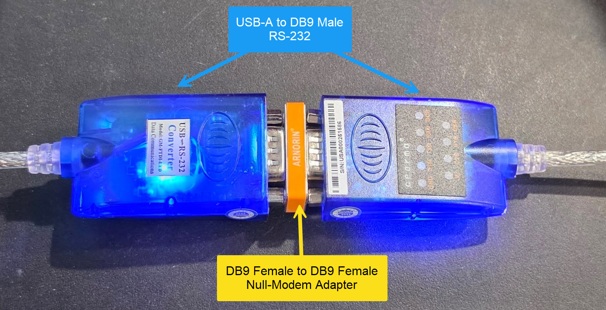
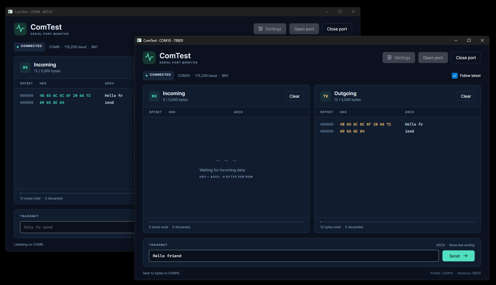

# ComTest

A .NET 11 / Avalonia 12 desktop serial monitor for Windows 11 and macOS (Apple Silicon and Intel). The project currently pins the .NET 11 RC2 SDK and matching `System.IO.Ports` package. Avalonia desktop uses the native macOS backend; no MAUI workloads are required.

The original purpose of this app was to test [Android Serial Port library](https://github.com/anotherlab/UsbSerialForAndroid) that I maintain.  I usually test it against actual serial port devices, but it's handy have to an app to show what is coming over the wire to test that library.

## Design
This started out as a vibe-coded exercise. The design is loosely based on an proprietary app I wrote many years ago. That app was WPF nnly, I wanted a version that should be Mac friendly.  I wanted an updated test app to go with an open source project that I maintain. The AI generated code pretty much followed the same patterns I used, but it was much cleaner.

AI got the core code running and added a few unit tests. My contribution has been refining the UI and adding some common sense functionality.

Some people are bothered by vibe-coded apps. I'm not. It's another tool that can be used and abused.

The default COM settings are 119200 8N1. That works for most devices. If you have a device that requires different settings, you can change them in the **Settings** dialog.

## Run

Install the SDK selected in `global.json`, then run:

```sh
dotnet restore ComTest.slnx
dotnet run --project src/ComTest
```

1. Open **Settings**. Select a detected port from the editable dropdown, or enter a port such as `COM3` on Windows or `/dev/cu.usbserial-…` on macOS. **Refresh** detects newly attached devices.
2. Set baud rate, data bits, parity, stop bits, flow control, DTR and RTS to match the other device. Hardware flow control manages RTS automatically.
3. **Apply settings** changes this instance. **Save** writes the named profile, while **Load** reads it back. Close the port before changing settings.
4. Select **Open port** to listen. Type in **Data to send**, then select **Send** or press Enter. Select **Close port** to release the device. Captured bytes remain visible after closing.

Incoming and outgoing panels show the same bytes as hexadecimal and printable ASCII, eight bytes per row. Nonprintable/non-ASCII bytes appear as `.` so every byte stays aligned. Offsets are hexadecimal positions since the corresponding buffer was cleared. **Follow latest** controls automatic scrolling; **Clear** resets only that buffer and its counters.

The sender supports strict ASCII (the default), UTF-8, and hex pairs (`00 7F FF` or `007FFF`). ASCII rejects non-ASCII characters instead of silently changing them. Choose an optional LF, CR or CRLF suffix in Settings. Hex mode sends raw bytes. Incoming data is always displayed byte-for-byte; it is not decoded as UTF-8.

## Buffer behavior

`SerialSession.InBuffer` and `SerialSession.OutBuffer` are independent, thread-safe byte rings, each backed by exactly 5,000 bytes. **Immediately when a buffer reaches 5,000 bytes, it discards the oldest 512 bytes**, leaving 4,488 bytes. This rule is applied repeatedly even when a single incoming chunk exceeds capacity. Between discards, the retained count is at most 4,999. Total and discarded counters appear below each panel.

Serial driver reads run on a background worker, with a 200 ms timeout so an idle reader can stop. Writes run off the UI thread, with a two-second driver timeout per 256-byte chunk. OutBuffer records each chunk after a successful driver write. A failed write may have transmitted part of its failing chunk; serial drivers cannot report that exact partial count or confirm receipt by the other device. Closing disposes the port and awaits the reader; unplugging a device reports the read error and releases the connection. The UI refreshes at most once every 75 ms.

## Configuration and multiple instances

The configuration file is `ComTest.json` under:

- Windows: `%LOCALAPPDATA%\ComTest\ComTest.json`
- macOS: `~/Library/Application Support/ComTest/ComTest.json`

The JSON contains named profiles, each divided into `SerialPort`, `Sending`, and `Display` sections. See `examples/ComTest.example.json`. Startup loads `Default`, or the profile specified on the command line. A missing profile starts with defaults and never automatically opens a port. A malformed file is reported and is not overwritten by Save.

```sh
dotnet run --project src/ComTest -- --profile "Port A"
dotnet run --project src/ComTest -- --profile "Port B"
dotnet run --project src/ComTest -- --config ./ComTest.json --profile "Port A"
```

There is no single-instance lock. Each process owns its own serial port and buffers. Named profiles share one JSON file safely through an exclusive save lock, read/merge, and atomic replacement; saving one profile preserves the others. If two instances save the same profile, the last save wins. The profile and process ID appear in the window title and footer.

For a null-modem test, connect two serial ports with a null-modem cable (or configure an OS virtual serial-port pair). Launch two instances, select a different port in each, use matching line settings, and open both ports. Each instance's OutBuffer should match the other's InBuffer. On Windows, start `ComTest.exe` twice. On macOS, launch an additional app instance with:

```sh
open -n ./artifacts/osx-arm64/ComTest.app --args --profile "Port A"
open -n ./artifacts/osx-arm64/ComTest.app --args --profile "Port B"
```

## Hardware testing.
This app was tested with an RFID reader that was configure to use COM over USB.  I also tested with a null-modem connection with two serial cables. I ran two instances of ComTest, each one configured with a different port.  Each instance's OutBuffer should match the other's InBuffer.

### Hardware used
USB to Serial RS-232 Adapter with LED Indicators, FTDI Chipset
It has USB-A on one end and a DB9 male connector on the other.
This cable is available from Amazon and (I assume) other online retailers.

I have two of them and used a null-model adapter, DB9 female on each end, to connect them to each other. When connected to the computer, they show up as separate COM ports.  It allows you test apps like this with minimal effort.



With both cables connected to each other and to a PC, and two instances of ComTest, each one configured with a different port, You can send some text from one instance and see it appear in the other instance's InBuffer.



Here are the Amazon links to the [Serial RS-232 Adapter](https://www.amazon.com/dp/B00AHYJWWG) and the [null-model adapter](https://www.amazon.com/dp/B075XGRLXW). No affliate code, just the links.

## Build, test, and publish

```sh
dotnet build ComTest.slnx -c Release
dotnet test ComTest.slnx -c Release
```

Tests cover exact rollover boundaries, large/random chunking, concurrent snapshots, codecs, simultaneous profile saves, serial lifecycle failures, and two independent sessions exchanging binary data over a simulated null-modem link. Headless Avalonia tests exercise the main and settings windows. To save rendered UI screenshots, set `COMTEST_SCREENSHOT_DIR` before running tests.

Create self-contained builds (the target computer does not need .NET installed):

```powershell
./scripts/Publish.ps1 -Runtime win-x64
./scripts/Publish.ps1 -Runtime win-arm64
./scripts/Publish.ps1 -Runtime osx-arm64
./scripts/Publish.ps1 -Runtime osx-x64
```

On macOS:

```sh
bash scripts/publish-macos.sh osx-arm64
# Intel Mac:
bash scripts/publish-macos.sh osx-x64
```

Outputs are under `artifacts/<runtime>/`. Windows includes `ComTest.exe`; macOS includes a `ComTest.app` bundle. When copying a bundle produced on Windows, restore executable permission on `ComTest.app/Contents/MacOS/ComTest` with `chmod +x`. The macOS script sets this automatically. These scripts produce local unsigned builds; signing/notarization for distribution is separate.

## Source layout

- `src/ComTest.Core`: buffers, codecs, profile storage, serial transport and lifecycle.
- `src/ComTest`: Avalonia UI, settings dialog, and view models.
- `tests/ComTest.Tests`: core integration tests and headless UI tests.

## Open issues / things to do
The port refreshing code doesn't always work right away. I also want to add platform specific code to identify what is connected to the serial port.
I want to add the usual housekeeping features, like a way to save and restore the window position and size. Light/Dark mode. Custom icons. Localized text. Error handling, Basic cleanup of save profiles. The usual sort of things.

Framework references: [Avalonia supported platforms](https://docs.avaloniaui.net/docs/supported-platforms), [Avalonia package](https://www.nuget.org/packages/Avalonia/12.1.4), [.NET 11 SDK](https://dotnet.microsoft.com/en-us/download/dotnet/11.0).
